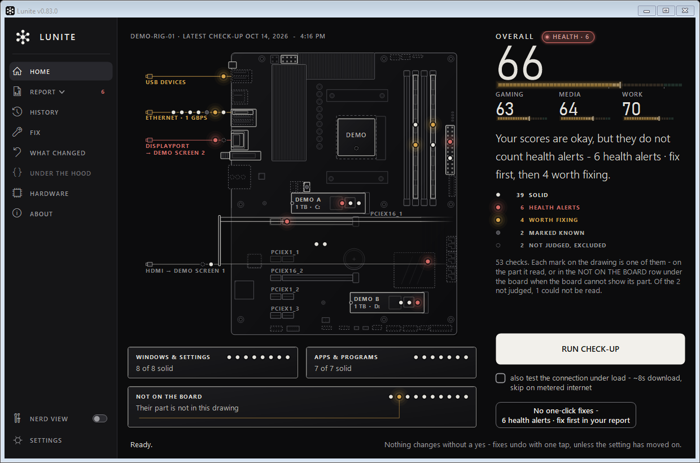
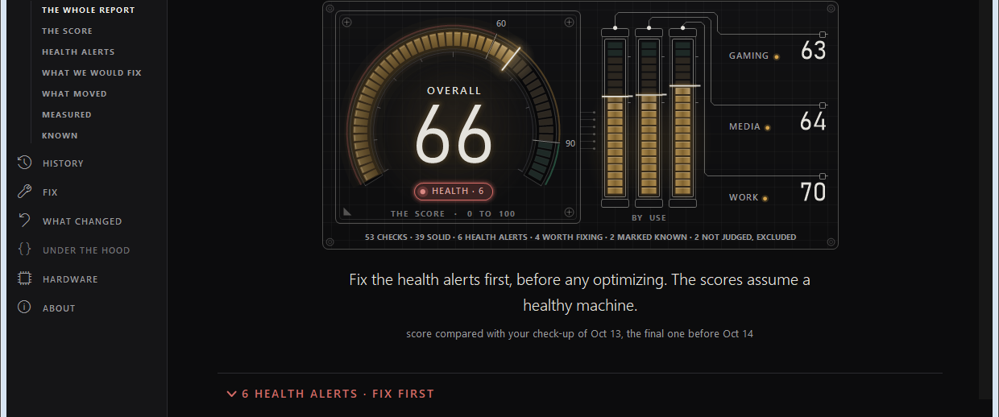

# LUNITE

Questions, a confusing screen, a report that looks wrong: **luniteapp@gmail.com**. Or open SETTINGS > SEND A REPORT inside the app.

**An honest PC check-up for Windows.** Lunite reads your PC's real settings and hardware, scores only what it actually verified, and says plainly what it could not read. It changes nothing without your yes, and every fix it applies has its own UNDO. Three things cannot be undone: removing a program and clearing Windows' leftover folders (both in their own room, marked permanent), and DELETE MY RECORDS in SETTINGS, which erases your saved check-ups and report cards for good but leaves the undo record, so fixes you applied can still be undone.

Lunite is free to use today ([what will change later](#is-it-really-free)).

> **Certus is now Lunite.** Same app, same records, same checks. Older releases on the Releases page may carry the earlier name, Certus. Releases before v0.83.0 are not signed, so download the newest one.

## What it looks like





*Pictures from a made-up demo PC ("DEMO-RIG-01"), not a real person's computer.*

## What you need

- A Windows 10 or Windows 11 PC. Open the download link on the PC, not on your phone.
- No installer, and administrator access is optional. Lunite is one portable file, `Lunite.exe`.
- An internet connection only for the few things listed under [Privacy](#privacy). The check-up itself works without one.

## Download and run

1. Download **`Lunite.exe`** from **[Releases](https://github.com/lpatino7/lunite/releases/latest)** (under *Assets*). Save it in a folder of its own, because Lunite keeps its results and report cards beside it.
2. Run it. The first time, Lunite shows a short version of its terms before the app opens (they stay in ABOUT, under TERMS AND NAMES). The full terms, which also cover sharing the app and how a sent report is kept, are in [LICENSE](LICENSE). By running Lunite you agree to the full LICENSE, including the parts the first-run screen leaves out.
3. Click **RUN CHECK-UP**. The check-up changes no settings on your PC, and saves only its own files (results, report cards and its own working records). Two built-in Windows tools that it runs, the benchmark and the program-update listing, may keep their own logs.
4. Changes happen only later, on the FIX screen. Every fix has its own tick box, and a fix arrives ticked only when your check-up found a real problem for it and it undoes in one tap. Untick anything you don't want.

Three measurements (memory speed, drive speed, startup time) come from Windows' built-in benchmark and need administrator access. The report says when they were skipped and why, and on an administrator account it offers a restart-with-access button.

### The first time you run it

- **Lunite is signed.** Windows shows the publisher as **Luis Patino**. To see it yourself: right-click `Lunite.exe` > Properties > Digital Signatures.
- **Windows usually asks for administrator access each time Lunite starts,** if your Windows account is an administrator (most home PCs). The prompt should name **Luis Patino** as the verified publisher. **Yes** lets the check-up read a few more things, and it still changes no settings. **No** still opens Lunite, and those few checks are marked "needs administrator access" instead of being guessed.
- **SmartScreen may still warn for a while.** A signed app with a new file can still get the blue "Windows protected your PC" screen until the file builds a download history with Microsoft. If you see it:
  1. Click **More info**.
  2. Check the **Publisher** line. It must say **Luis Patino**. If it says "Unknown publisher" or any other name, close the window, don't run the file, delete it, and email luniteapp@gmail.com.
  3. If it says Luis Patino, click **Run anyway**.
- **Your browser** (Edge, Chrome) may say the file "isn't commonly downloaded". That is the same reason. In the browser's downloads list choose **Keep** (you may need **Show more** > **Keep anyway**), then check the publisher as above.
- **Smart App Control** (Windows 11): if yours is turned on, it should let Lunite open, because the file is signed. The check-up hasn't been tested with it turned on, so some checks may come back unread. If it blocks Lunite or the check-up looks wrong, email luniteapp@gmail.com.
- **You will see `powershell.exe` running.** `Lunite.exe` carries PowerShell scripts that do the reading and the fixes. It writes them to a folder and runs them with no window and with `-ExecutionPolicy Bypass`, so a sandbox or antivirus report may call that suspicious. Without administrator access, the folder is under `%LOCALAPPDATA%\PCOptimizer`. With it, the folder is an admin-only one in `C:\Windows\Temp`, so programs without administrator rights can't change the scripts.

<!-- Sources, read 2026-11-03: https://support.microsoft.com/en-us/topic/what-is-smart-app-control-285ea03d-fa88-4d56-882e-6698afdb7003
(a valid signature lets an app run) and https://learn.microsoft.com/en-us/windows/apps/package-and-deploy/code-signing-options
(Artifact Signing gives no instant SmartScreen trust; new files can warn until they build reputation). -->

If none of that is enough for you, don't run it. That's a reasonable call, and the next section is there so you don't have to take anyone's word for it.

### Check what you downloaded

Every release lists the SHA-256 of its exe in the release notes. Open the folder where you saved it, click the address bar, type `powershell` and press Enter. Then run:

```
Get-FileHash .\Lunite.exe -Algorithm SHA256
(Get-AuthenticodeSignature .\Lunite.exe).Status
(Get-AuthenticodeSignature .\Lunite.exe).SignerCertificate.GetNameInfo('SimpleName',$false)
```

The hash must match the one in the [release notes](https://github.com/lpatino7/lunite/releases/latest). The second line must say `Valid`, and the third must say `Luis Patino`. If any of them is off, don't run it: email luniteapp@gmail.com.

## What a check-up covers

Over forty checks (the exact number depends on your PC: a laptop adds battery checks, a desktop adds board checks), in plain words:

- **Health first:** blue screens (each crash Windows recorded, with the stop code it wrote down), graphics driver restarts, low memory and how the page file is set, devices Device Manager shows a problem on, the disk error log, drive health warnings, antivirus state, the CPU speed-limit log, unexpected power-loss history, and Windows 10 support dates. Red findings are **health alerts**: they light a red lamp beside your score and are listed first. They never get a one-click fix.
- **Settings that cost you performance:** power plan, monitor refresh rate, mouse acceleration, background game recording, startup load, screen sleep, network adapter power saving, graphics driver age.
- **Hardware truths:** memory running below its rated speed, single-channel memory, old motherboard firmware, drive health and real free space, fast USB devices linked below their speed, damaged-cable tells on wired links, power settings that hold the processor back, Secure Boot and TPM (which some games' anti-cheat needs).
- **Extra programs at startup:** programs that start themselves with Windows, from the check-up's short list (an extra security suite beside Windows Security, cleaner and driver-updater tools, preinstalled offers and search add-ons). Each one is described by what kind of program it is. Your PC maker's own drivers and tools are never counted as extras, and neither is Windows Security.
- **Network:** double-router paths, who answers your name lookups, how quickly your router answers, and, only if you tick it, how your ping holds up while the line is busy.
- **Sound:** the default microphone pick.

Every check ends one of a few honest ways: read and fine, flagged with the evidence, not judged, or marked *could not read* (and why, such as needing administrator access). A check that could not be read is left out of the score and listed. It is never guessed.

## Scores

Three scores (Gaming, Media, Work) plus an overall, computed only from checks that were actually read on your PC. Some checks are advice rather than problems and cost no points. The report says what each number was built from, including what could not be read. Health alerts are not part of the score, which is why they get their own red lamp.

## Fixes and undo

The report separates what the app can fix with one click from what needs guided steps or your own hands. For one-click fixes, each one has its own tick box before anything runs, every applied change records its exact before-value, and the **WHAT CHANGED** screen lists every change with its own UNDO button. If a setting has moved on since, or the undo record could not be saved, it says so instead. Guided and hardware items (BIOS settings, cables, dust) are explained step by step; the app never touches those itself.

**Removals are walled off.** Removing a program and clearing Windows' leftover folders live in their own room, behind their own consent, and the room says plainly that a removal cannot be undone. When you approve a program's removal, the app runs that program's *own* uninstaller, whose window and prompts are yours to answer. Afterwards the app checks whether the program is actually gone and tells you either way.

Any finding can be marked **"I know about this."** It stops counting against your score and stays in your report. The next check-up looks at it again and brings it back if it got worse.

## Privacy

- **Stays on your PC:** your check-ups and report cards. No account, no telemetry, no analytics, no automatic crash reporting. Lunite uploads none of them itself, but if you run it from a folder that OneDrive or a similar service syncs (a OneDrive-backed Desktop, for example), that service copies them like any other file.
- **Sent only when you press SEND** on the SEND A REPORT screen (its See the exact card link shows the report first). A sent report holds:
  - your report card, with this PC's name left out and serial numbers that carry a label Lunite recognises (like Serial Number or S/N) left out. A number under another label can stay in, so open See the exact card and read the whole report first;
  - a short code that stands for this PC (the same code each time you send from it, so two reports from one PC can be matched);
  - the app and Windows versions, the newest crash note if there is one, the time you sent it, and anything you typed.
- **Where it goes:** a small Google script on Lunite's Google account saves it in that account's Google Drive and emails it to luniteapp@gmail.com. Both copies are kept for up to a year, then deleted automatically.
- **To have your sent reports deleted sooner:** email luniteapp@gmail.com, quote your tag (the short code the SEND A REPORT screen shows) and say roughly when you sent the report. The tag is the same for every report sent from this PC, so one tag covers them all, and the date helps, because a short code can be shared by two PCs. Write it down before you remove Lunite. If you lost it, email anyway and say roughly when you sent the report.
- **Other network calls:** the update check, name-server timing, the optional connection test, Windows' own program-update listing and pings to your own router. ABOUT in the app lists every one of them. The program-update listing asks winget, which is Microsoft's program, not ours: depending on your Windows diagnostic-data setting, it may send Microsoft its own usage data.

## Updates

**CHECK FOR UPDATES** is on the SETTINGS screen. A new build installs only after you say yes and only after it passes two checks: its SHA-256 matches the published manifest, and its RSA signature verifies against the key built into the app, so a file that was changed fails these checks and is not installed. If the swap fails, the app puts your old build back.

## Removing Lunite completely

Lunite has no installer, so it has no uninstaller either.

**Quick version:** undo any fix you want undone (WHAT CHANGED), press DELETE MY RECORDS in SETTINGS, close Lunite and delete `Lunite.exe`, then delete the folder `%LOCALAPPDATA%\PCOptimizer` (PCOptimizer is Lunite's older internal name). The full list below also covers the rarer leftovers: a few small files beside the app, a scheduled task, a saved DNS setting, and reports saved somewhere else.

If you ever sent a report, first write down your tag from the SEND A REPORT screen (see step 9).

**Full cleanup**, in order. The same steps are in the app, under ABOUT > REMOVING LUNITE COMPLETELY.

1. **Undo what you want undone first.** Removing Lunite undoes nothing. Open WHAT CHANGED and press UNDO on any fix you want undone, while Lunite can still read its undo record.
2. **Turn the no-popup switch off, if you turned it on.** In SETTINGS, press POPUP OFF ON THIS PC - CLICK TO BRING IT BACK. That deletes the scheduled task named `Lunite`. The switch only shows for a copy of Lunite installed under Program Files. If Lunite is already gone, open Task Scheduler as Administrator and delete the task named `Lunite` there.
3. **Delete your records.** In SETTINGS, press DELETE MY RECORDS. It deletes the check-ups, report cards and other records kept next to the app, and it cannot be undone. It leaves the main undo record on this PC, so fixes you applied can still be undone, and it does not delete reports you already sent (see step 9).
4. **Close Lunite and delete the app.** In the folder you run it from, delete the Lunite program you run (usually `Lunite.exe`) and, if an update left them beside it, the copy whose name ends in `.previous.exe` and `Lunite.update.exe`. Then delete only these files Lunite made there, if any are left:
   - `crash-note-(date and time).txt`
   - `update-check-on-launch.txt`
   - `license-key.txt` (only if you were ever given a key)
   - `report-card-this-pc-(date and time)-sent.html`
   - the records named after a PC that ran Lunite from that folder (this one, if you skipped step 3, or another), each with any backup copies beside it: `scan-results-(PC name).json`, `ack-(PC name).json`, `readout-(PC name).txt`, `scan-pace-(PC name).txt`, `removals-(PC name).json`, `ledger-(PC name).json` or `ledger-(PC name)-(code).json`, and `report-card-(PC name)-(date and time).html`

   Leave every other file there alone - it is not Lunite's.
5. **Delete this PC's own Lunite folder.** It is `%LOCALAPPDATA%\PCOptimizer`, and it holds the main undo record, the activity log, the board labels setting and the note that you saw the terms. Once it is gone, nothing Lunite changed can be undone from Lunite.
6. **Remove the DNS record, only if you ever used the DNS switch.** Lunite saved the DNS it replaced under the registry key `HKLM\SOFTWARE\Lunite`. The DNS switch itself is undone in step 1 (WHAT CHANGED). If you skipped that and want your old DNS back now that Lunite is gone, set it yourself in Windows Settings: your network connection > DNS server assignment (or IP assignment) > Edit (Automatic, unless you had typed in your own servers before). Removing the key is optional and skipping it is harmless. To remove it: open Registry Editor as Administrator, go to `HKEY_LOCAL_MACHINE\SOFTWARE`, right-click the key named `Lunite` and choose Delete. Delete nothing else.
7. **Delete copies kept elsewhere.**
   - A report that could not be sent: on your Desktop, as `lunite-report-(code)-(date and time).html`
   - A report preview from SEND A REPORT: in your Temp folder (`%TEMP%`), as `lunite-report-preview-(code).html`
   - A report card that could not be saved next to the app: in `%TEMP%`, as `report-card-(...).html`
   - If you ever said Yes to the administrator prompt: in Windows' own Temp folder (`C:\Windows\Temp`), the folders named `lunite-run-(code)`. They hold only Lunite's own scripts, and deleting them needs administrator access.
8. **Restore points can stay.** The one Lunite asks Windows to make before fixes stays in System Restore. Windows deletes old restore points on its own, and you can remove them yourself under System Protection.
9. **Reports you already sent** are not on your PC, and none of the steps above touch them. To have them deleted, email luniteapp@gmail.com and quote your tag (one tag covers every report sent from this PC). If you lost it, email anyway and say roughly when you sent them.

## FAQ

**Does it make my games faster?**
Lunite doesn't promise a speed-up. It finds settings and hardware that are holding your PC back, tells you what it found and how sure it is, and lets you choose what to change. Results depend on your PC.

### Is it really free?

Yes, today. Everything in this version is free: the check-up, the scores, the report, the written how-to steps and the one-click fixes. A later version will charge once for the app applying fixes for you. The check-up, scores, report and written steps stay free, and any PC already using Lunite before then keeps the one-click fixes free.

---


**Does it need administrator access?**
No, but it asks. On an administrator account, Windows usually shows the prompt each time Lunite starts, and you can say No. Without it, a few checks are marked "needs administrator access" instead of being guessed. On an administrator account, the report also offers a restart-with-access button if you want them.

**Will it change anything on its own?**
No. The check-up changes no settings on your PC. Settings change only when you approve a fix on the FIX screen. Some fixes arrive ticked because your check-up found a real problem for them; untick anything you don't want. Each fix has its own UNDO.

**Why does the score not count my health alert?**
A health alert (a blue screen, a failing drive) is about your PC's health, not how well it is tuned, so it gets its own red lamp instead of being hidden inside a number. Look at those first, and if a drive is failing, back up your files before anything else.

**My score changed and I didn't change anything.**
Updates can re-grade a check. In v0.83.0 several advice-only checks stopped costing points, so a score may move at your next check-up.

**Something looks wrong in my report.**
That's worth knowing. Email luniteapp@gmail.com or use SETTINGS > SEND A REPORT, and read the report before you send it.

## Terms

Lunite is provided as is, without any warranty; see [LICENSE](LICENSE). Product and company names Lunite shows belong to their owners, and Lunite is not affiliated with, endorsed by or sponsored by any of them.

## Security

Found a security problem? Please report it privately - see [SECURITY.md](SECURITY.md).

## Support

Email **luniteapp@gmail.com**, or use SETTINGS > SEND A REPORT inside the app.

---

Free to use today. All rights reserved: the app may not be redistributed, modified or rehosted without permission (see [LICENSE](LICENSE)).
